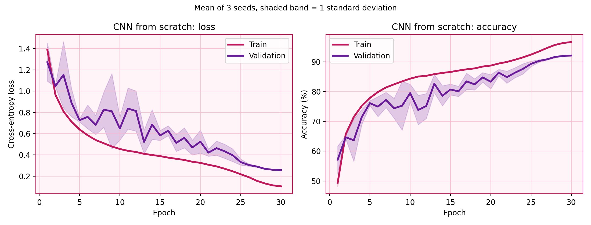
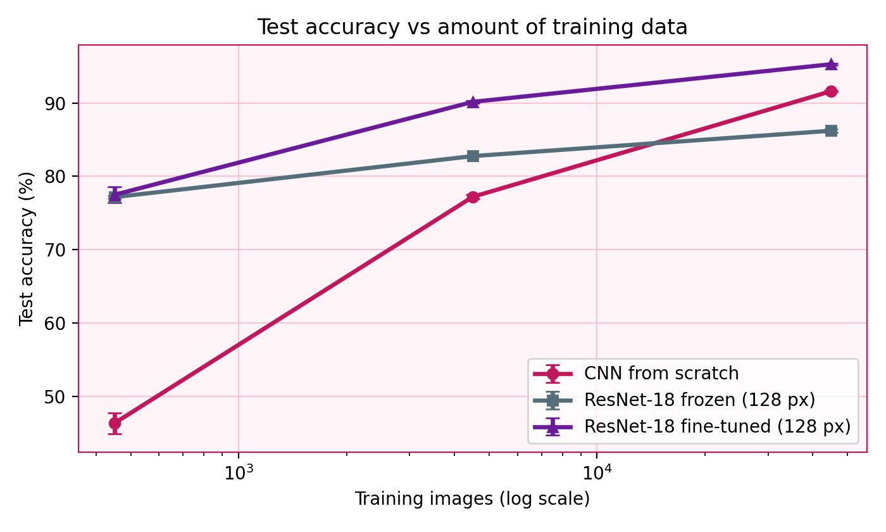

# CIFAR-10: training from scratch vs transfer learning

When is a pre-trained network worth it, and when is a small CNN trained from scratch enough? I compared both on CIFAR-10 (50,000 training images, 32x32 pixels, 10 classes), on accuracy, training time, inference speed and the amount of labeled data each one needs.

This was an assignment for MGSC 673 (Introduction to Artificial Intelligence and Deep Learning) in the Master of Management in Analytics at McGill, November 2026. Everything ran on the GPU of a MacBook Air M3.

## Results

| Model | Test accuracy | Trained params | Training per run | Time to 85% val. | Inference (img/s) |
|---|---|---|---|---|---|
| CNN from scratch, 30 epochs | 91.62% ± 0.12 | 1.15M | 16.0 min | 10.4 min | 4,420 |
| CNN from scratch, 60 epochs (1 seed) | 92.29% | 1.15M | 28.9 min | 18.4 min | 4,560 |
| ResNet-18 frozen, 128 px | 86.22% ± 0.19 | 5,130 | 0.7 min | 0.7 min | 1,267 |
| ResNet-18 fine-tuned, 32 px | 81.39% ± 0.10 | 11.2M | 2.7 min | not reached | 6,279 |
| ResNet-18 fine-tuned, 128 px | 95.30% ± 0.13 | 11.2M | 19.0 min | 2.3 min | 1,094 |
| ResNet-18 fine-tuned, 224 px | 95.92% ± 0.11 | 11.2M | 66.8 min | 8.2 min | 318 |

Mean ± standard deviation over 3 seeds, on the 10,000 test images. Each run keeps its best epoch on a 5,000 image validation set, and that checkpoint is scored once on the test set.



With less data, the gap grows:

| Training images | CNN from scratch | ResNet-18 frozen | ResNet-18 fine-tuned (128 px) |
|---|---|---|---|
| 450 (1%) | 46.32% | 77.17% | 77.48% ± 1.05 |
| 4,500 (10%) | 77.21% | 82.76% | 90.16% |
| 45,000 (100%) | 91.62% | 86.22% | 95.30% |



## What I found

Fine-tuned ResNet-18 beats the CNN by 3.7 points at 128 pixels and 4.3 at 224. Training the CNN for twice as many epochs only closes 0.7 points of that gap, so the difference is not a question of training budget.

The pre-trained weights are not better by default. Frozen, the ImageNet features stay below the CNN. Fine-tuned on the native 32x32 images, ResNet-18 gives the worst result of all, because its first layers shrink a 32x32 image to a 1x1 map. It needs upsampled inputs to pay off.

The amount of labeled data matters most. With 450 images the pre-trained models reach about 77% against 46% for the CNN, and the frozen and fine-tuned versions are tied, which matches Kornblith et al. (2019). From 4,500 images, fine-tuning is 7.4 points ahead of the frozen network, and with the full set even the CNN passes it.

My recommendation: with a few hundred labeled images, or to get a baseline in under a minute, I would use a frozen pre-trained network. From a few thousand images, full fine-tuning is worth its extra minutes. Training from scratch makes sense when there is a lot of labeled data and the model has to be compact and work on small native images without upsampling. CIFAR-10 is an easy case for transfer, since ImageNet contains the same kind of objects; on X-rays or satellite images I would expect a smaller benefit, but I did not test it.

## How it is built

- The whole dataset sits on the GPU as uint8 (about 180 MB), and the augmentation (random crop with 4 pixel padding, horizontal flip) runs there as tensor indexing, so the data loader is never the bottleneck.
- The CNN has three blocks of two 3x3 convolutions with batch normalization, max pooling and dropout, then global average pooling. It trains with SGD (Nesterov) and a one-cycle learning rate.
- ResNet-18 keeps its ImageNet weights with a new 512 to 10 layer. The frozen version caches the 512 features once and trains only the last layer. The fine-tuned version uses AdamW with 1e-4 for the pre-trained layers and 1e-3 for the new one, with warmup then cosine decay.
- The CNN and the fine-tuned ResNet share the same stratified split, training loop and augmentation.
- Every run writes its results to a JSON file in `results/`. If the file exists, the run is not trained again and its epoch log is printed back, so the notebook replays in a few minutes.
- The 85% validation threshold for "time to 85%" was fixed before any run.

## Reproduce

```bash
pip install -r requirements.txt
jupyter notebook cifar10_scratch_vs_transfer.ipynb
```

As is, the notebook reads the saved results and rebuilds every table and figure without training. CIFAR-10 downloads into `data/` on the first run. To retrain a run, delete its JSON file in `results/`. `split_indices.pt` holds the train and validation split used for every run. The device is picked automatically (Apple MPS, then CUDA, then CPU), and `A3_SMOKE=1` runs a quick end-to-end test on a small subset.

## Limitations

All times come from one MacBook Air M3. I did not run a hyperparameter search: the values are standard choices fixed before the runs, so each model could probably do a little better. The frozen network had no augmentation, and ResNet-18 sees upsampled, blurry images. The time to 85% is only checked at the end of each epoch, so at 224 pixels (8 minute epochs) it is an upper bound. With 450 and 4,500 images, five of the six fine-tuning runs and two of the three 10% CNN runs had their best epoch at the last one, and ResNet-18 at 32 pixels was still improving at epoch 8, so more epochs might have helped those runs.

## Reference

Kornblith, S., Shlens, J., and Le, Q. V. (2019). Do Better ImageNet Models Transfer Better? CVPR 2019. [arXiv:1805.08974](https://arxiv.org/abs/1805.08974)
